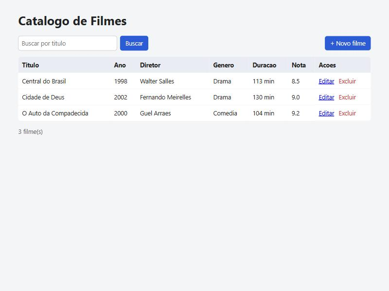
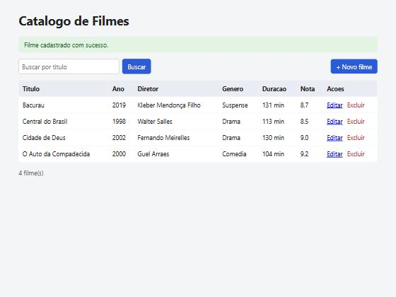
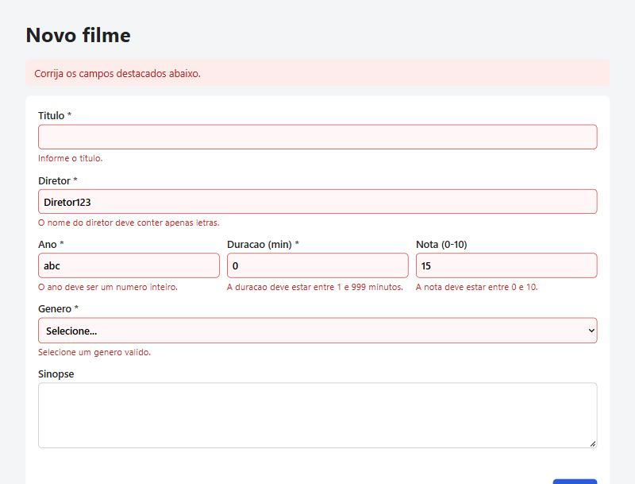
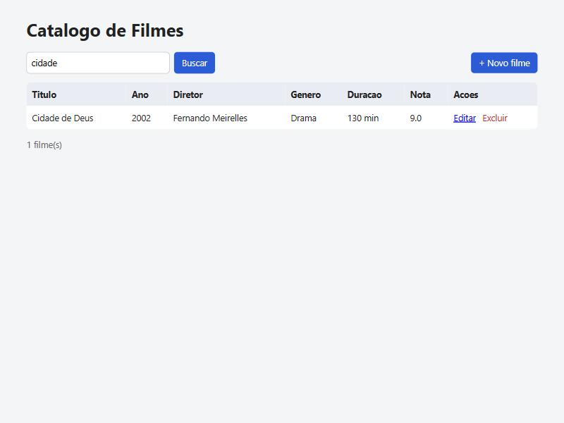
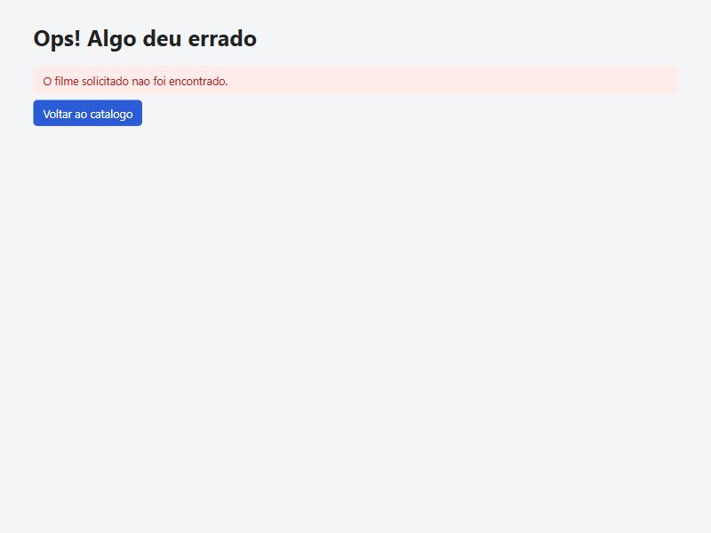

# Catálogo Simples de Filmes

Aplicação web em **Java (Servlet + JSP + JDBC + MySQL)** com CRUD completo de filmes,
desenvolvida para o Projeto Integrador Transdisciplinar em Ciência da Computação.
Foco na **Situação-problema 2 – Tratamento de Exceções e Validação de Dados**.

## Funcionalidades
- Cadastrar, listar, buscar por título, editar e excluir filmes.
- Validação **no servidor** de todos os campos, com mensagem ao lado de cada campo.
- Regra de negócio: não permite o mesmo filme (título + ano) duas vezes.
- Erros técnicos (banco fora do ar, id inexistente) mostram página amigável; o detalhe vai só para o log.

## Telas

| Listagem | Cadastro com sucesso |
|---|---|
|  |  |

| Validação com erros por campo | Busca por título |
|---|---|
|  |  |

| Filme não encontrado (erro tratado) |
|---|
|  |

## Arquitetura (MVC em camadas)
```
JSP (view) → FilmeServlet (controller) → FilmeValidator → FilmeService (regras) → FilmeDAO/FilmeDAOJdbc → MySQL
```

| Pacote | Responsabilidade |
|---|---|
| `model` | `ItemCatalogo` (abstrata), `Filme`, `Genero` (enum) |
| `validation` | `FilmeValidator` – converte e valida a entrada do formulário |
| `exception` | `ValidacaoException`, `ItemNaoEncontradoException`, `PersistenciaException` |
| `dao` | `FilmeDAO` (interface), `FilmeDAOJdbc` (PreparedStatement), `ConnectionFactory` |
| `service` | `FilmeService` – regras de negócio |
| `controller` | `FilmeServlet`, `ValoresFormulario` |

## Tratamento de exceções
| Situação | Exceção | O que o usuário vê |
|---|---|---|
| Campo vazio, texto no lugar de número, valor fora da faixa | `ValidacaoException` (todos os erros juntos) | Formulário de volta, com o que digitou e mensagens por campo (HTTP 400) |
| Filme duplicado | `ValidacaoException` | Mensagem no campo título |
| Id inexistente ou adulterado na URL | `ItemNaoEncontradoException` / `NumberFormatException` | Página "filme não encontrado" (HTTP 404) |
| Falha de banco (`SQLException`) | `PersistenciaException` | Mensagem amigável (HTTP 503); stack trace só no log |
| Qualquer outro erro | `error-page` no `web.xml` | Página de erro genérica |

## Como executar
Pré-requisitos: JDK 17+ e Maven 3.9+.

### Jeito rápido (VS Code, banco H2 embutido)
1. Abra a pasta no VS Code (com o *Extension Pack for Java*).
2. **Terminal → Executar Tarefa → "Rodar catalogo (Jetty)"** (ou `mvn jetty:run`).
3. Acesse `http://localhost:8080/catalogo-filmes/`.

O H2 cria sozinho a tabela e os filmes de exemplo (arquivo `data/catalogo.mv.db`).

### Com MySQL 8 e Tomcat 10.1+
1. Crie o banco: `mysql -u root -p < sql/schema.sql`
2. Em `src/main/resources/db.properties`, comente o bloco H2 e ative o bloco MySQL com sua senha.
3. Gere o pacote: `mvn clean package`
4. Copie `target/catalogo-filmes.war` para a pasta `webapps` do Tomcat (ou use `mvn jetty:run`).

O código é o mesmo nos dois bancos: só muda o `db.properties`.

## Testes
- `FilmeValidatorTest` – 7 testes de validação (entrada válida, campos opcionais, acúmulo de erros, limites, tentativa de injeção).
- `FilmeServiceTest` – 5 testes das regras de negócio usando um DAO em memória (sem banco).
